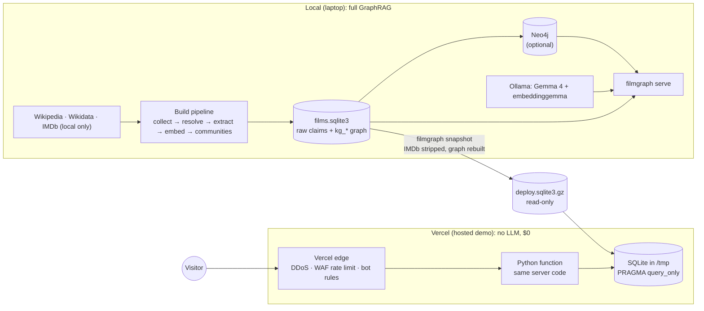
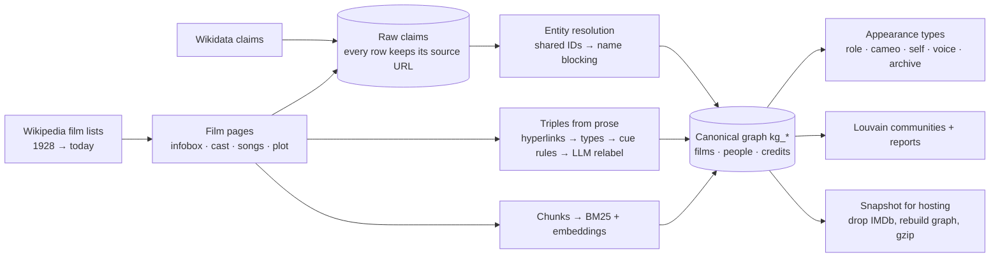
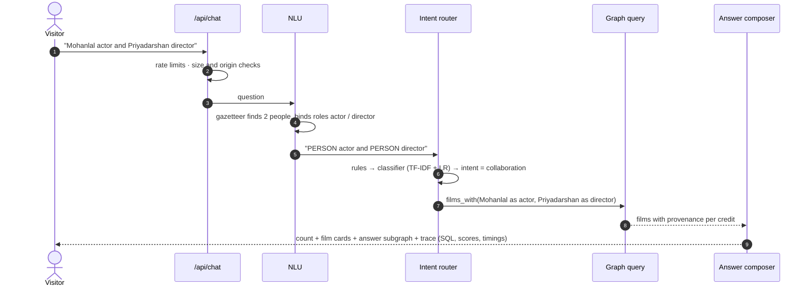

# Malayalam FilmGraph — GraphRAG over Malayalam cinema

**Live demo: [malayalam-filmgraph.vercel.app](https://malayalam-filmgraph.vercel.app)** — ask in plain English, then open
*How this was answered* to see the entities, intent scores and the exact SQL behind every answer.

A proof-of-concept **GraphRAG** system: a knowledge graph of Malayalam cinema (films, people, songs, places,
remakes, adaptations, awards) that you can question in plain English. It shows answers as chat cards with
Wikipedia / IMDb / YouTube / where-to-watch links, an interactive graph that highlights the result, and a
step-by-step trace of how each answer was produced.

It is built **deterministic-first, local-model-second**. An intent router plus entity recognition fills
parameterised graph queries; this is the same pattern as a Grakn + Dialogflow assistant. Small local models
(Ollama) are used only for relation extraction, plot search, era summaries and NLU fallback.
**No paid AI API is used.**

| | |
|---|---|
| Graph | 6,791 films · 23,729 people · 132k credit triples · 13k songs / 39k song credits · ~4.9k link-anchored relation triples (remakes, adaptations, shooting locations, awards, debuts…) · 17.7k text chunks · 74k Neo4j nodes / 240k relationships |
| Sources | Wikipedia film lists and pages (CC BY-SA) · Wikidata (CC0) · IMDb non-commercial datasets (**local only**, never deployed) |
| Stores | Neo4j 5.26 (Docker or AuraDB Free) **or** a SQLite mirror with the same query templates |
| Models | `gemma4-e4b` (chat/JSON) + `embeddinggemma` (embeddings) via Ollama, both local; optional WebLLM in the browser |
| Quality | see [`evals/report.md`](evals/report.md): intent accuracy, entity-linking F1, count exactness vs ground-truth SQL, retrieval ablation, Neo4j/SQLite parity |

More detail: [`docs/graphrag.md`](docs/graphrag.md) (architecture, diagram, design decisions, interview notes) ·
[`docs/product-and-cost-plan.md`](docs/product-and-cost-plan.md) (product, quotas, costs).

---

## 0. Try it

Answers below are from the live demo (hosted mode: no LLM, every number comes from a graph query).

| Question | Answer (abridged) |
|---|---|
| *How many films did Mohanlal and Mammootty do together?* | **53 films** with both on screen: 46 in full roles, 7 where one is a cameo or plays himself. Narration-only credits (*Barroz*, *Pathonpatham Noottandu*) are listed separately |
| *Mohanlal actor and Priyadarshan director* | **30 films** (1984–2021), e.g. *Marakkar* (2021), *Oppam* (2016) |
| *Which director has Mammootty worked with most?* | **Joshiy** and **I. V. Sasi**, 33 films each |
| *Who directed Chemmeen?* | **Ramu Kariat** (1966) |
| *Songs sung by K. J. Yesudas composed by Raveendran* | **174 songs** (1979–2006) |
| *How is Fahadh Faasil connected to Prem Nazir?* | **2 films apart**, via M. B. Sreenivasan |
| *Which films are remakes of Manichitrathazhu?* | *Chandramukhi* and 3 more, each with its evidence sentence |
| *Films shot in Munnar* | **10 films** (2011–2025) |
| *Films like Kireedam* | *Chenkol* first: shared creatives fused with plot similarity |
| *Mohanlal movies in the 90s* | **65 films** (1990–1999) |

Follow-ups keep context: *Mohanlal and Mammootty films* → *what about with Priyadarshan?* → *only in the 90s*.

### Architecture: local full version vs hosted demo



### Build process (offline)



### How one question is answered



## 1. What you can ask

| Intent | Example | How it is answered |
|---|---|---|
| collaboration | *How many films did Mohanlal and Mammootty do together?* · *Mohanlal actor and Priyadarshan director* | `films_with` template, role-scoped, distinct film count |
| filmography | *Mohanlal movies in the 90s* · *what did Sushin Shyam compose music for* | same template, one person, year slots |
| top collaborators | *Which director has Mammootty worked with most?* | co-credit aggregation |
| film crew / info | *Who directed Chemmeen?* · *Tell me about Thanmathra* | credits + extracted relations + plot passage |
| songs | *Songs sung by K. J. Yesudas composed by Raveendran* | song-level + film-level music credits |
| connection path | *How is Fahadh Faasil connected to Prem Nazir?* | shortest path over credits (bidirectional BFS / Cypher `shortestPath`) |
| relations | *Which films are remakes of Manichitrathazhu?* · *films based on novels* | link-anchored triples with evidence sentences |
| by attribute | *Films shot in Munnar* · *first CinemaScope films* | facts + `SHOT_AT`/`SET_IN` triples |
| plot search | *Movie where a family hides a murder from the police* | hybrid vector + BM25 (weighted RRF), optional graph pre-filter, grounded answer with citations |
| similar films | *Films like Kireedam* | shared key creatives (graph) fused with plot similarity (vectors) |
| global overview | *What were the major filmmaker circles in the 80s?* | Louvain communities + community reports (GraphRAG global search) |
| help / handover / out of scope | *talk to a human* | canned flows; handover writes a ticket and posts to Slack if configured |

**Relationship-aware answers.**
- *Actors named together* ("Mohanlal and Mammootty movies") means films where **both play a real role on screen**.
  Cameos, appearances as themselves, voice/narration and archive footage are listed separately with the reason
  (from `kg_appearances`, built from the cast-line text and infobox of each film page). The graph puts the two people
  on either side and the films between them, with one styled edge per credit.
- *Mixed professions* ("Mohanlal and M. G. Sreekumar") counts any shared credit and breaks it down by pairing, e.g.
  *Mohanlal actor × M. G. Sreekumar singer: 54 films · actor/singer × singer: 13*.
- A person plus a place, technology, genre or company ("Mohanlal films shot in Ooty") must satisfy **both** constraints.

**Provenance on every edge.** Each credit records which sources assert it (Wikipedia / Wikidata / IMDb):
- answers count only films where every credit is on the film's own Wikipedia page (✓ confirmed);
- Wikidata/IMDb-only links are listed separately with ⚠ and drawn as dashed edges in the graph.

**Ratings and corrections.**
- Every answer has 👍/👎 and *Suggest a correction*: what's wrong, the correct value, and a public https proof link
  (required when a number or name is claimed).
- Corrections go to a review queue; nothing a user submits changes the graph until a curator accepts it
  (`filmgraph feedback`, `--accept ID` / `--reject ID`).
- Storage: local runs use `data/feedback.sqlite3`; hosted runs use a private Supabase table through the signed gateway,
  limited to 30 submissions/hour per reporter.

**Walkthrough of one query through the code:** `python scripts/explain_query.py "mohanlal and mammokka movies"` writes
[`docs/walkthrough.md`](docs/walkthrough.md). It covers every function that ran (`file:line`), its inputs and outputs, the
Cypher, row counts and provenance.

Follow-ups carry context: *"Mohanlal and Mammootty films"* → *"what about with Priyadarshan?"* →
*"only in the 90s"*. Ambiguous names ("Mohan") get clarification buttons instead of a guess.

## 2. How it works

```
question ─► gazetteer NER + entity linking ─► intent router ─► dialogue manager ─► intent flow ─► answer + cards + graph + trace
               (38k names/titles/places,        rules → TF-IDF/LR      (slots, carry-over,     │
                fuzzy + "mohan lal" repair)     → local LLM fallback    clarify, handover)      ├─ Cypher / SQL template
                                                                                                ├─ hybrid retrieval (vector + BM25)
                                                                                                └─ community reports
```

1. **Collection** (`catalogue.py`, `wikidata_catalogue.py`, `imdb.py`). Every Wikipedia annual list from 1928 on, every
   linked film page (infobox, cast, soundtrack tables, plot and production text) and Wikidata film claims are
   collected. Exact-ID IMDb enrichment is local only. Requests are rate-limited and cached, and every claim keeps its source URL.
2. **Entity resolution** (`kg.py`). Union-find over shared identifiers (Wikidata QID, IMDb nm, wiki slug), then name
   blocking. Same-name records that share a film are merged; source-scoped names attach to a dominant anchored
   person (≥5× the films of any rival) or stay separate. 47.9k raw person records become 23.7k people, and
   duplicate films are merged by (title, year). Raw tables are never modified; the canonical graph lives in `kg_*`.
3. **Triples from prose** (`extract.py`). Wikipedia hyperlinks give exact entity linking for free:
   - stage A: 70k linked mentions
   - stage B: targets typed via Wikidata P31 and descriptions
   - stage C: cue rules (*remake of*, *based on*, *shot in*, *won*…)
   - stage D: the local LLM relabels weak `MENTIONS` edges, choosing from a closed relation list. Hallucinated
     entities or relations are rejected.

   Each triple stores its sentence, source, method and confidence.
4. **Lexical graph + vectors** (`retrieval.py`). Lead, plot and production text is split into chunks and embedded locally.
   Search uses BM25 (FTS5) plus dense vectors, fused by weighted Reciprocal Rank Fusion.
5. **Communities** (`communities.py`). Louvain on the person-person collaboration graph produces a fact sheet per
   community, plus an LLM report written only from that fact sheet.
6. **Graph stores** (`graphstore.py`, `graphdb.py`). The same query templates exist in Cypher (Neo4j) and SQL (SQLite).
   The Neo4j loader uses batched `UNWIND`, typed relationships (`ACTED_IN`, `DIRECTED`, `SCORED`, `SANG`,
   `REMAKE_OF`, `SHOT_AT`…), a full-text index and a vector index. An empty Neo4j never answers; `auto` falls back to SQLite.
7. **NLU** (`nlu.py`). Longest-match gazetteer, role binding ("*X actor and Y director*", "*composed by Z*"), year and
   decade slots. Questions are delexicalised (`how many films did PERSON and PERSON…`), then routed:
   - rules first;
   - otherwise a TF-IDF + logistic-regression classifier, re-weighted by slot compatibility;
   - the local LLM only below 0.5 confidence. Its mentions are re-linked through the gazetteer.
8. **Pipeline** (`pipeline.py`). One function per intent. Numbers and names always come from queries; the LLM only
   narrates retrieved passages and must cite them. Dialogue context round-trips through the client, so the server
   is stateless and works on serverless.
9. **UI** (`static/`). Chat with answer cards, clarification buttons, suggestions, sources, and a "How this was
   answered" panel (entities, classifier scores, the exact Cypher/SQL, per-stage timings). The vis-network graph
   redraws to the answer subgraph, with role/decade clustering. There is also a Chrome side panel (`chrome-extension/`).

## 3. Run it locally

```bash
cd malayalam-film-graphrag
python3 -m venv .venv && .venv/bin/pip install -e '.[graphrag]'
docker compose up -d                     # Neo4j 5.26 → http://localhost:7474 (neo4j / filmgraph-local)
ollama pull embeddinggemma               # + a chat model; default FILMGRAPH_LLM_MODEL=gemma4-e4b-32k:latest

# (only on a fresh checkout — takes hours, resumable)
.venv/bin/filmgraph import-catalogue && .venv/bin/filmgraph import-wikidata && .venv/bin/filmgraph enrich-pages --workers 4

# derived GraphRAG layers (minutes)
.venv/bin/filmgraph build-kg
.venv/bin/filmgraph build-appearances        # role / cameo / as-self / voice / archive per acting credit (~3 min, cached pages)
.venv/bin/filmgraph build-chunks && .venv/bin/filmgraph embed
.venv/bin/filmgraph extract-triples --llm-films 60
.venv/bin/filmgraph communities --summaries 25
NEO4J_URI=bolt://localhost:7687 NEO4J_PASSWORD=filmgraph-local .venv/bin/filmgraph load-neo4j

# serve
NEO4J_URI=bolt://localhost:7687 NEO4J_PASSWORD=filmgraph-local FILMGRAPH_LOCAL_GUEST_LIMIT=500 .venv/bin/filmgraph serve
# → http://127.0.0.1:8765   (toggle "Local LLM" and "Graph: Neo4j / SQLite" under the chat box)

.venv/bin/filmgraph chat --backend neo4j          # terminal chat with traces
.venv/bin/python scripts/evaluate.py --neo4j --llm # → evals/report.md
.venv/bin/python -m unittest discover -s tests     # 32 tests
```

All settings are in [`.env.example`](.env.example): Neo4j/AuraDB credentials, LLM provider (`ollama` | `openai`-compatible | `none`),
Slack handover webhook, Supabase keys, local guest limit.

The **⚙ Settings** dialog (next to *My collection*) overrides data paths, models and graph backend, which sources count
(and which count as ✓ confirmed), which prose relations are answered, and which credits connection paths walk through.
Defaults are the env/built-in values above. Only changed values are saved, to `data/settings.json` (`FILMGRAPH_SETTINGS`),
and they apply from the next question. Saving works only from a local (loopback) request, and settings are read-only on Vercel.
Secrets stay in `.env`.

## 4. Hosted version (Vercel)

The live demo runs in **public demo mode**: a read-only snapshot of the graph inside one Python function, with no
database server, no accounts and no LLM. Supabase accounts (below) are optional and currently switched off.

- **No LLM runs on the server.** Answers use rules + classifier + graph; plot search uses BM25 only (no vectors), so
  plot recall is lower than locally (see `evals/report.md`). The classifier ships as JSON weights
  (`src/filmgraph/models/intent.json`), so the function needs only NumPy. `/model-lab.html` can load a small model in
  the visitor's browser (opt-in).
- **IMDb data never deploys.** `filmgraph snapshot` strips IMDb-sourced claims, re-attributes credits that
  Wikipedia/Wikidata also support, then **rebuilds every derived table** (graph, appearance types, chunks,
  communities). Hosted counts are therefore a little lower than local ones. `python scripts/check_snapshot.py`
  compares the top 300 people between the full graph and the snapshot before each deploy.
- **Safety layers**

  | Layer | Protection |
  |---|---|
  | Vercel edge | automatic DDoS mitigation; WAF rule blocking exploit probes (`/.env`, `/wp-admin`, …); rate limit 120 API requests/min per IP; AI-bot ruleset |
  | Function | 60 API calls/min per IP; 10 questions/min and 40 distinct questions/day per visitor; JSON-only POST, same-origin check, 64 KB body cap, bounded `limit`/`offset`; 20 s max duration |
  | Data | SQLite opened with `PRAGMA query_only` (writes fail); parameterised SQL only; the browser can send a whitelisted query plan, never SQL or Cypher |
  | Responses | CSP, `nosniff`, Referrer-Policy, Permissions-Policy, COOP; `X-Robots-Tag: noindex` on `/api/`; settings endpoint hides paths and hosts |
  | Crawlers | `robots.txt` allows the home page, disallows `/api/` and blocks AI-training crawlers |

  `tests/test_hosted_safety.py` covers the demo limits, read-only mode, settings redaction and throttling.
- **Deploy** from a machine that has the snapshot (Git builds are disabled because the snapshot is git-ignored):

  ```bash
  filmgraph snapshot && python scripts/check_snapshot.py && vercel deploy --prod
  ```

  Vercel environment: `FILMGRAPH_PUBLIC_DEMO=1`, `FILMGRAPH_READONLY=1`, `FILMGRAPH_LLM=none`, `FILMGRAPH_GRAPH=sqlite`,
  `FILMGRAPH_TRACE_LOG=0`, `FILMGRAPH_ACCOUNTS_DB=/tmp/filmgraph-accounts.sqlite3`. The project's framework preset
  must be **Other**; the Python preset ignores `api/`.
- **Optional accounts (Supabase, off).** Setting `SUPABASE_URL`, `SUPABASE_PUBLISHABLE_KEY` and
  `FILMGRAPH_GATEWAY_SECRET` (min 32 bytes, also stored in the edge function secrets) switches quotas to Postgres
  (`filmgraph_consume_quota` behind the HMAC-signed `filmgraph-gateway`) and enables sign-in, favourites and feedback.
  Free Supabase projects pause after 7 idle days, which is why the public demo does not depend on it.

## 5. Costs

| Item | Now (pilot) | If a paid tier launches |
|---|---|---|
| Vercel | Hobby $0 (personal / non-commercial only) | Pro ≈ $20 per member / month |
| Supabase | Free $0 (50k MAU, 500 MB; pauses after 7 idle days) | Pro $25 / month |
| Neo4j | local Docker $0, or AuraDB Free $0 (200k nodes / 400k rels, 1 GB) | AuraDB Professional ≈ $65 / GB / month |
| LLM / embeddings | $0 (local Ollama; optional in-browser model) | none planned; any API would need explicit approval |
| **Total** | **$0** | **≈ $110 / month** before usage overages |

Prices were checked on 22 Oct 2026 and some come from third-party summaries; confirm on each vendor's pricing page.
A paid tier also requires: no IMDb-derived data (already enforced), Vercel Pro (Hobby is non-commercial), and
Wikipedia attribution / share-alike for reused text.

## 6. Data and licensing

- Wikipedia text: CC BY-SA 4.0; chunks keep page URLs. Wikidata: CC0.
- IMDb non-commercial datasets: personal local research only; excluded from every snapshot and deployment.
- Letterboxd: not used (no permitted catalogue access).
- OTT links are search links (JustWatch / YouTube) unless a source page linked an official video. Availability is not verified.

## 7. Known limits

- Coverage follows Wikipedia/Wikidata. Some well-known films are missing or merged incorrectly upstream; counts are
  labelled "in the catalogue".
- People without external IDs are resolved by name. Very common single names stay ambiguous and trigger clarification.
- Prose triples cover hyperlinked phrases only (precision over recall). LLM relabelling has run on 60 films so far.
- The gold sets (50 structured + 29 plot questions) are hand-built regression suites, not a benchmark. RRF weights were chosen on the plot set.
- The browser UI was verified through its API and syntax checks; a full visual pass in Chrome is still pending.
- Without IMDb identifiers, a few spelling variants stay separate in the hosted graph (e.g. "G. Venkitaraman" vs
  Wikipedia's "G. Venkittaraman"); the credits are present under the Wikipedia spelling.

## 8. Repository layout

```
src/filmgraph/
  catalogue.py wikidata_catalogue.py imdb.py http.py   collection (cached, rate-limited)
  db.py                                                raw claims + provenance schema
  kg.py                                                entity resolution → kg_* canonical graph
  extract.py                                           link-anchored triple extraction (rules + local LLM)
  retrieval.py                                         chunks, embeddings, BM25, weighted RRF
  communities.py                                       Louvain + community reports
  graphstore.py graphdb.py                             Cypher/SQL templates; Neo4j loader
  nlu.py                                               gazetteer NER, role/time slots, 3-tier intent router
  pipeline.py                                          dialogue manager, intent flows, cards, graphs, handover
  llm.py                                               Ollama / OpenAI-compatible client (local by default)
  server.py accounts.py snapshot.py                    HTTP API, quotas/accounts, IMDb-free deploy snapshot
  static/                                              web UI (chat.js = GraphRAG chat) · models/ portable classifier
evals/      gold.jsonl plot_gold.jsonl report.md      scripts/  evaluate.py build_graphrag.py
supabase/   migrations + filmgraph-gateway             chrome-extension/  side panel
docs/       graphrag.md product-and-cost-plan.md architecture.md
```
