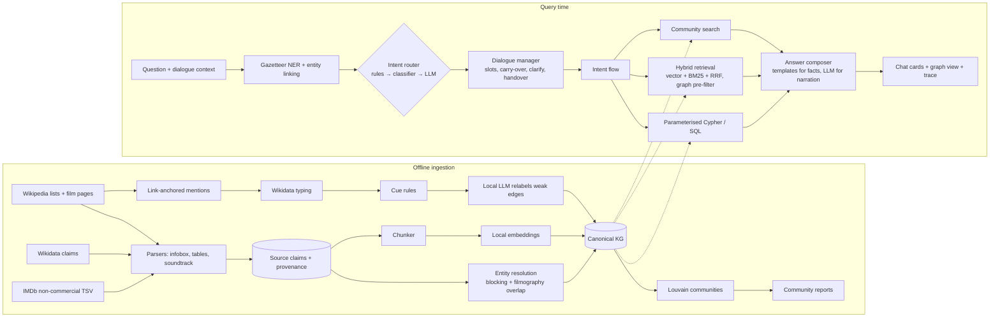

# FilmGraph GraphRAG — architecture and design notes

A knowledge-graph question-answering system over Malayalam cinema (≈6.8k films, 23.7k people,
132k credit triples, 39k song credits, 17.7k text chunks, link-anchored relation triples).
It is built **deterministic-first**: intent rules and parameterised graph queries answer every
factual question; small local models handle only the parts that need language understanding or
generation. No paid API is required.

## Pipeline



## How the parts map to standard GraphRAG / RAG practice

| Practice | Where it lives | Notes |
|---|---|---|
| Knowledge-graph construction with provenance | `catalogue.py`, `wikidata_catalogue.py`, `imdb.py` → `credits`, `facts`, `credit_sources` | Every claim keeps its source URL. Raw tables are never overwritten by derived layers. |
| Entity resolution | `kg.py` | Union-find over external IDs → name blocking → merge anchored records sharing a film → attach source-scoped names to a dominant anchor (≥5× films) or keep them separate. 47.9k raw person records → 23.7k people. |
| Triple extraction (structured) | parsers | (person)-[ROLE]->(film) from infoboxes, cast tables, soundtrack tables, Wikidata properties. |
| Triple extraction (unstructured) | `extract.py` | Wikipedia hyperlinks give exact entity linking at no cost. Targets are typed through Wikidata P31 and descriptions. Cue rules label relations; a local LLM relabels the remaining `MENTIONS` edges from a **closed relation set**, and drops any hallucinated entity. |
| Lexical graph | `retrieval.py`, `graphdb.py` | `(:Chunk)-[:PART_OF]->(:Film)`, the same pattern as Neo4j's KG builder. |
| Hybrid retrieval | `retrieval.hybrid_search` | Dense (embeddinggemma, local) + BM25 (FTS5), fused with Reciprocal Rank Fusion (k=60). |
| Graph-constrained retrieval | `flow_plot_search` | NER constraints (person, year) pre-filter candidate films before vector search: "the Mohanlal film where…". |
| Text-to-query, safely | `nlu.py` + `graphstore.py` | Intent + slots fill whitelisted Cypher/SQL templates. User text never becomes query text. Roles and relation types come from enums. |
| GraphRAG local search | `film_info`, `similar_films`, `plot_search` flows | Entity-centred context: credits + triples + passages, then grounded generation with citations. |
| GraphRAG global search | `communities.py`, `flow_global_overview` | Louvain communities over the collaboration graph. Each gets a fact sheet and LLM reports written only from it. Questions retrieve relevant reports, then map/reduce into an answer. |
| Grounded generation | `pipeline.GROUNDED` | Numbered context, mandatory citations, abstention. Counts and names are never generated by the LLM. |
| Dialogue management | `pipeline.answer` | Stateless context round-trip (works on serverless), follow-up carry-over, slot clarification, entity disambiguation buttons. |
| Human-in-the-loop | `pipeline.handover` | Explicit request or two low-confidence turns → ticket (`data/handover.jsonl`), plus Slack if `SLACK_WEBHOOK_URL` is set. |
| Observability | response `trace`, `data/traces.jsonl` | Every answer shows intent, method, confidence, linked entities, the exact Cypher/SQL, row counts and per-stage latency. |
| Evaluation | `scripts/evaluate.py`, `evals/` | Intent accuracy, entity-linking F1, count exactness against independent SQL, retrieval hit@k/MRR ablation, backend parity, latency. |
| Pluggable stores and models | `graphstore.open_store`, `llm.py` | Neo4j (local/AuraDB Free) or SQLite mirror. Ollama by default, or any OpenAI-compatible endpoint (vLLM, Groq, Gemini/Claude compatibility endpoints) only when configured. |

## The intent → flow design (the Grakn/Dialogflow pattern)

1. **NER first.** The gazetteer does a longest match over 38k names, aliases, titles, places and technologies. Fuzzy and concatenation repair handle "mamooty" and "mohan lal". Stray aliases never beat an exact name.
2. **Delexicalise.** "how many films did Mohanlal and Mammootty do together" becomes "how many films did PERSON and PERSON do together". The classifier then learns question *shape*, not names, so it transfers to unseen people and to other film industries.
3. **Route in three tiers.**
   - Regex rules fire for high-precision patterns (handover, degrees of separation, remakes).
   - TF-IDF + logistic regression handles the rest, with probabilities multiplied by **slot compatibility**: a collaboration needs two people.
   - The local LLM is consulted only below 0.5 confidence, and its mentions are re-linked through the gazetteer.
4. **Flow.** Each intent is a function: check slots, carry over or clarify, run a parameterised query, compose a deterministic answer, and optionally let the LLM narrate retrieved text.

This answers the cost question directly. Most traffic needs **no LLM call at all**: NER + routing take about 1–10 ms on CPU, and graph queries take milliseconds. The LLM is reserved for plot search, global questions and NLU fallback. The same split moves to the browser: the gazetteer + classifier (or WebLLM in `model-lab.html`) can run client-side, with the server only validating plans.

## Run it

```bash
docker compose up -d                       # Neo4j 5.26 at bolt://localhost:7687 (neo4j / filmgraph-local)
ollama pull embeddinggemma                 # local embeddings; chat model: FILMGRAPH_LLM_MODEL
filmgraph build-kg                         # entity resolution -> kg_* tables
filmgraph build-chunks && filmgraph embed  # lexical graph + vectors
filmgraph extract-triples                  # mentions -> typing -> rules -> LLM relabel (200 films)
filmgraph communities                      # Louvain + community reports
NEO4J_URI=bolt://localhost:7687 NEO4J_PASSWORD=filmgraph-local filmgraph load-neo4j
NEO4J_URI=bolt://localhost:7687 NEO4J_PASSWORD=filmgraph-local filmgraph serve   # http://127.0.0.1:8765
filmgraph chat --backend neo4j             # terminal chat with traces
python scripts/evaluate.py --llm --neo4j   # writes evals/report.md
```

**AuraDB Free:** create a free instance, then set `NEO4J_URI=neo4j+s://<id>.databases.neo4j.io` and its password, and run `load-neo4j`. The loader prints node/relationship totals and whether they fit the free tier (200k nodes / 400k relationships). GDS is not needed: communities are computed in Python and written back as `(:Community)` nodes.

## Known limits (say these before an interviewer finds them)

- Coverage follows Wikipedia/Wikidata. Some well-known titles are missing or merged incorrectly upstream; counts are labelled as catalogue counts.
- Entity resolution is name-based for people without IDs. Common single names (e.g. "Mohan") stay ambiguous and trigger a clarification instead of a guess.
- Relation triples from prose cover only linked phrases. Unlinked mentions are not extracted, which is deliberate: precision over recall.
- The gold set is small and hand-built (see `evals/`). It is a regression suite, not a benchmark.
